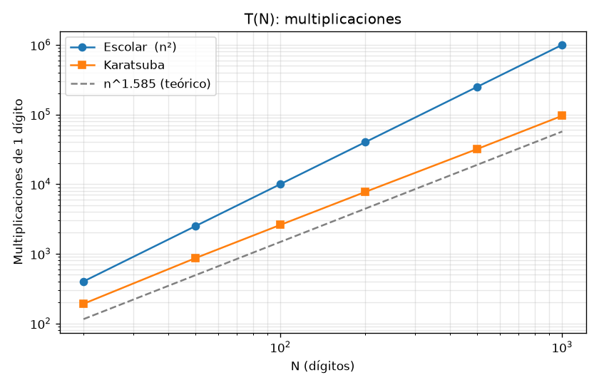
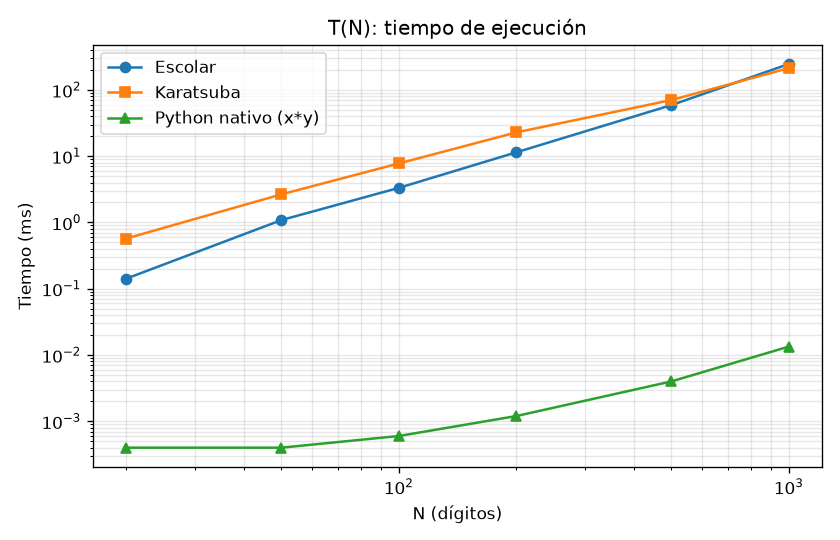
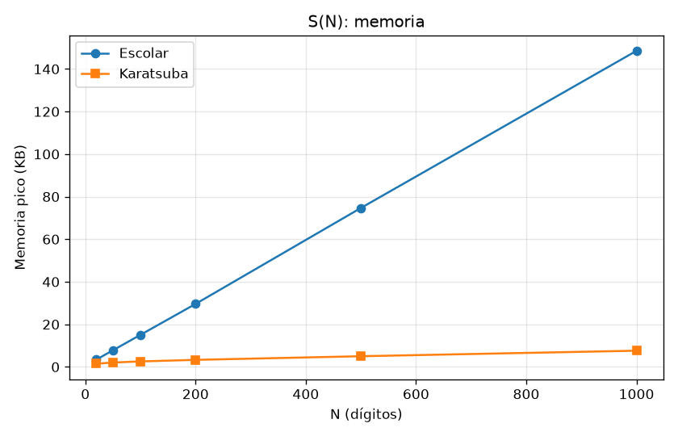

# Actividad 14: Algoritmo de Karatsuba (Divide y Vencerás)

Implementación **recursiva** del algoritmo de Karatsuba para multiplicar enteros gigantes
(20, 50, 100 dígitos y más), con medición de **T(N)** y **S(N)** y pruebas que comparan el
resultado contra la multiplicación sin el algoritmo.

## Estructura del repositorio

| Archivo | Contenido |
|---|---|
| [karatsuba.py](karatsuba.py) | Algoritmo de Karatsuba recursivo (con variante híbrida por umbral) y multiplicación escolar O(n²) para comparar |
| [test_karatsuba.py](test_karatsuba.py) | Pruebas de funcionamiento con `unittest` |
| [benchmark.py](benchmark.py) | Mide T(N) y S(N), genera tablas y gráficas |
| [resultados/](resultados/) | CSV, tablas Markdown y gráficas generadas por el benchmark |

## Cómo ejecutar

Requisitos: Python 3.10+. `matplotlib` es opcional y solo se usa para las gráficas.

```bash
python karatsuba.py          # ejemplo con dos números de 40 dígitos
python -m unittest -v        # pruebas de funcionamiento
python benchmark.py          # medición de T(N) y S(N)
```

---

## 1. El problema

Con el método de primaria, multiplicar dos números de *n* dígitos requiere multiplicar cada
dígito de uno por cada dígito del otro: **n² multiplicaciones de un dígito**. Para 100 dígitos
son 10 000 multiplicaciones.

Anatoli Karatsuba (1960) demostró que se puede hacer con muchas menos aplicando
**Divide y Vencerás**.

## 2. El algoritmo y sus 3 fases

Sean `x` y `y` dos números de *n* dígitos y `m = n/2`.

### Fase 1: División

Cada número se parte en una mitad alta y una mitad baja:

```
x = a·10^m + b
y = c·10^m + d
```

Ejemplo: `x = 1234, y = 5678` ⇒ `a = 12, b = 34, c = 56, d = 78`.

### Fase 2: Conquista

Si se desarrolla el producto directamente aparecen **4** multiplicaciones (`ac`, `ad`, `bc`, `bd`):

```
x·y = ac·10^(2m) + (ad + bc)·10^m + bd
```

Karatsuba observa que `ad + bc = (a+b)(c+d) − ac − bd`, así que basta con **3**
multiplicaciones recursivas:

```
z2 = a · c
z0 = b · d
z1 = (a + b) · (c + d)
```

Cada una se resuelve llamando de nuevo a Karatsuba, hasta llegar al **caso base**: números de un solo dígito.

### Fase 3: Integración de la solución

```
x·y = z2·10^(2m) + (z1 − z2 − z0)·10^m + z0
```

Multiplicar por `10^k` solo es un desplazamiento (agregar `k` ceros), y las sumas y restas
cuestan O(n). Ninguna de las dos cuenta como multiplicación de dígitos.

Ejemplo completo (`1234 × 5678`):

```
z2 = 12 × 56           = 672
z0 = 34 × 78           = 2652
z1 = (12+34)(56+78)    = 46 × 134 = 6164
medio = 6164 − 672 − 2652 = 2840
resultado = 672·10^4 + 2840·10^2 + 2652 = 7 006 652  ✔
```

En el código, cada fase está marcada con un comentario
(`# 1. DIVISIÓN`, `# 2. CONQUISTA`, `# 3. COMBINACIÓN`) dentro de `_karatsuba` en
[karatsuba.py](karatsuba.py).

## 3. Análisis de complejidad

### Tiempo T(N)

| Algoritmo | Recurrencia | Solución |
|---|---|---|
| Escolar | — | **O(n²)** |
| Divide y vencerás ingenuo (4 subproblemas) | T(n) = 4T(n/2) + O(n) | O(n²), no mejora nada |
| **Karatsuba** (3 subproblemas) | **T(n) = 3T(n/2) + O(n)** | **O(n^log₂3) ≈ O(n^1.585)** |

Por el Teorema Maestro: con `a = 3`, `b = 2` y `f(n) = O(n)`, como `n^log₂3 ≈ n^1.585`
crece más rápido que `f(n)`, se cae en el **caso 1** y `T(n) = Θ(n^log₂3)`.

### Espacio S(N)

En cada momento solo una rama de la recursión está activa, y cada nivel guarda números de
tamaño proporcional a su subproblema:

```
S(n) = S(n/2) + O(n)  ⇒  S(n) = O(n)
```

La profundidad de la pila es **O(log n)**: 7 niveles para 20 dígitos y 13 para 1000.

## 4. Resultados medidos

Generados con `python benchmark.py` (Python 3.11, Windows 11). Los tiempos son la mediana de 7
repeticiones y cambian de una máquina a otra; los conteos de multiplicaciones son exactos.

### 4.1 Karatsuba vs. multiplicación escolar

| N (dígitos) | Mult. Karatsuba | Mult. escolar (n²) | Ahorro | t Karatsuba (ms) | t escolar (ms) | t Python nativo (ms) | Memoria Karatsuba (KB) | Memoria escolar (KB) | Profundidad |
|---:|---:|---:|---:|---:|---:|---:|---:|---:|---:|
| **20** | 191 | 400 | 52.2 % | 0.57 | 0.14 | 0.0004 | 1.51 | 3.42 | 7 |
| **50** | 867 | 2 500 | 65.3 % | 2.66 | 1.09 | 0.0004 | 2.03 | 7.79 | 8 |
| **100** | 2 597 | 10 000 | 74.0 % | 7.77 | 3.33 | 0.0006 | 2.57 | 15.06 | 9 |
| 200 | 7 718 | 40 000 | 80.7 % | 22.83 | 11.43 | 0.0012 | 3.30 | 29.59 | 10 |
| 500 | 31 969 | 250 000 | 87.2 % | 70.32 | 58.94 | 0.0040 | 5.01 | 74.68 | 12 |
| 1000 | 95 727 | 1 000 000 | 90.4 % | 213.09 | 245.89 | 0.0134 | 7.61 | 148.52 | 13 |





**Observaciones**

* **Multiplicaciones:** Karatsuba siempre hace menos, y el ahorro crece con N: 52 % con 20
  dígitos y 90 % con 1000. La pendiente en escala log-log es paralela a la de `n^1.585`.
  El conteo real queda por encima de la curva teórica por un factor constante, porque
  `(a+b)` y `(c+d)` pueden tener un dígito más y porque los números rara vez tienen una
  longitud potencia de 2.
* **Tiempo real:** con pocos dígitos, el Karatsuba puro es *más lento* que el escolar porque
  cada llamada recursiva cuesta mucho más en Python que una multiplicación de dígitos. El
  punto de cruce ronda los 500–1000 dígitos; a partir de ahí Karatsuba gana y la ventaja
  crece. Esto motiva la variante híbrida (sección 4.2).
* **Memoria:** el método escolar guarda listas de dígitos que crecen linealmente con N. La
  memoria pico de Karatsuba también crece de forma lineal pero con una constante menor, y la
  profundidad de la pila crece de forma logarítmica (de 7 a 13 niveles).
* **Python nativo:** CPython ya usa Karatsuba internamente para enteros grandes, escrito en C,
  así que es miles de veces más rápido. Aquí sirve como referencia de que el resultado es correcto.

### 4.2 Variantes: umbral del caso base

En la práctica se deja de dividir cuando los números son "pequeños" (≤ umbral dígitos) y esos
casos se resuelven con el método escolar. `umbral = 1` es el Karatsuba puro.

| N | Umbral | Multiplicaciones | Tiempo (ms) | Memoria (KB) | Llamadas recursivas | Profundidad |
|---:|---:|---:|---:|---:|---:|---:|
| 20 | 1 | 202 | 0.499 | 1.73 | 265 | 7 |
| 20 | 4 | 209 | 0.220 | 1.86 | 40 | 4 |
| 20 | 8 | 247 | 0.131 | 2.11 | 13 | 3 |
| 20 | 16 | 310 | **0.106** | 2.55 | 4 | 2 |
| 50 | 1 | 872 | 1.763 | 2.22 | 1 123 | 8 |
| 50 | 4 | 985 | 0.778 | 2.43 | 127 | 6 |
| 50 | 8 | 1 173 | 0.653 | 2.61 | 40 | 4 |
| 50 | 16 | 1 484 | **0.485** | 3.31 | 13 | 3 |
| 100 | 1 | 2 538 | 5.159 | 2.64 | 3 226 | 10 |
| 100 | 4 | 2 837 | 2.386 | 2.89 | 370 | 7 |
| 100 | 8 | 3 461 | 1.516 | 3.10 | 121 | 5 |
| 100 | 16 | 4 412 | **1.275** | 3.74 | 40 | 4 |
| 1000 | 1 | 95 561 | 215.431 | 7.68 | 123 577 | 13 |
| 1000 | 16 | 177 157 | **51.602** | 9.04 | 1 429 | 8 |

Tabla completa (incluye umbral 32) en [resultados/variantes.md](resultados/variantes.md).

**Observaciones**

* Subir el umbral **aumenta** el número de multiplicaciones de dígitos, pero **reduce
  drásticamente** las llamadas recursivas. En Python, una llamada cuesta mucho más que una
  multiplicación de dígitos, así que el tiempo baja.
* Un umbral de alrededor de **16 dígitos** fue el más rápido en todos los tamaños. Con 1000
  dígitos, el híbrido (51.6 ms) es **4.8 veces más rápido** que el método escolar (245.9 ms) y
  4 veces más rápido que el Karatsuba puro.
* S(N): con un umbral mayor la pila es menos profunda (de 13 a 8 niveles con 1000 dígitos),
  aunque el caso base escolar usa un poco más de memoria en cada hoja.

## 5. Pruebas de funcionamiento

[test_karatsuba.py](test_karatsuba.py) compara Karatsuba contra la multiplicación escolar y
contra el operador `*` de Python (sin el algoritmo):

* Todos los productos de números pequeños (0–119).
* Números negativos, cero y uno.
* Números de longitudes distintas (100 × 7 dígitos).
* 25 pares aleatorios de **20, 50 y 100 dígitos**.
* Números de 1000 dígitos.
* Todas las variantes de umbral.
* Que Karatsuba haga **menos** multiplicaciones de dígitos que el método escolar (que hace
  exactamente n²).

```
$ python -m unittest -v
...
Ran 8 tests in 0.556s

OK
```

## 6. Conclusiones

1. Karatsuba aplica las tres fases de Divide y Vencerás: **divide** cada número en dos mitades,
   **conquista** con solo 3 multiplicaciones recursivas en lugar de 4 e **integra** el resultado
   con sumas, restas y desplazamientos.
2. Quitar una sola multiplicación por nivel baja la complejidad de O(n²) a O(n^1.585). Con 100
   dígitos esto ahorra 74 % de las multiplicaciones, y con 1000 dígitos el 90 %.
3. El espacio adicional es O(n) con una pila de profundidad O(log n).
4. En una implementación real conviene la variante híbrida: el Karatsuba puro minimiza las
   multiplicaciones, pero cortar la recursión en un umbral pequeño minimiza el tiempo real.

## Referencias

* Karatsuba, A., & Ofman, Y. (1962). *Multiplication of multidigit numbers on automata*.
  Doklady Akademii Nauk SSSR, 145(2), 293–294.
* Cormen, T. H., Leiserson, C. E., Rivest, R. L., & Stein, C. (2022). *Introduction to
  Algorithms* (4.ª ed.). MIT Press. Capítulo 4: Divide-and-Conquer.
* Knuth, D. E. (1997). *The Art of Computer Programming, Vol. 2: Seminumerical Algorithms*
  (3.ª ed.), §4.3.3.
